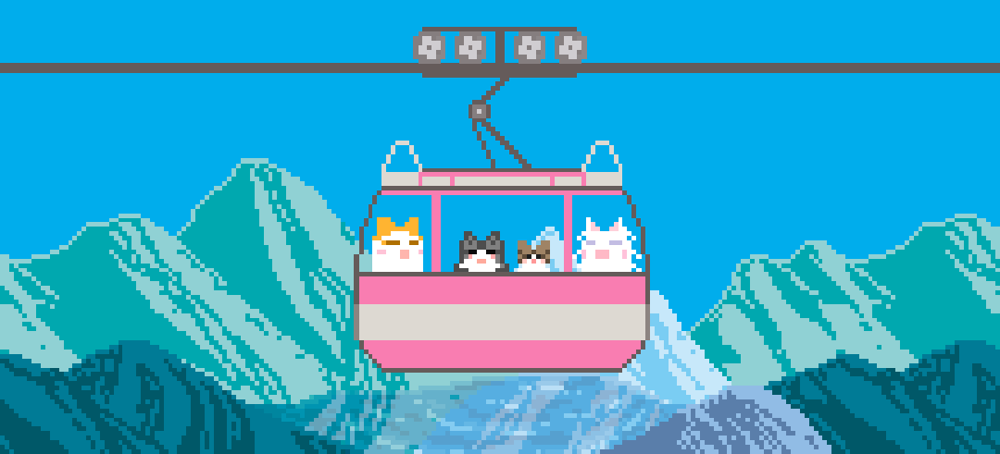

<h1 align="center">
  
</h1>
  <strong>Computer Engineering | AI & Data Science | Building thoughtful tech solutions</strong>

  I’m a final-year Computer Engineering student specialising in AI & Data Science.
  I enjoy building practical applications, exploring AI-powered experiences, and turning data into useful insights.

  
  
  

<h2 align="center">✦ What I'm Interested In</h2>

  <i>Exploring ideas, building practical solutions, and continuously learning.</i>

<table width="100%">
  <tr>
    <td align="center" width="50%">
      

        <h3>AI & Machine Learning</h3>
        
Exploring practical AI applications, intelligent systems, and explainable machine learning.

      

    </td>
    <td align="center" width="50%">
      

        <h3>Data Analytics</h3>
        
Discovering patterns, transforming data into insights, and creating meaningful dashboards.

      

    </td>
  </tr>
  <tr>
    <td align="center" width="50%">
      

        <h3>Full Stack Development</h3>
        
Building responsive web applications, backend systems, and seamless user experiences.

      

    </td>
    <td align="center" width="50%">
      

        <h3>Application Development</h3>
        
Creating and improving applications across web and Android platforms.

      

    </td>
  </tr>
</table>
 
<h2 align="center">✦ Technologies & Tools</h2>

  

  <picture>
    <source media="(prefers-color-scheme: dark)" srcset="https://raw.githubusercontent.com/KeerthanaSambhu/KeerthanaSambhu/output/github-contribution-grid-snake-dark.svg">
    <source media="(prefers-color-scheme: light)" srcset="https://raw.githubusercontent.com/KeerthanaSambhu/KeerthanaSambhu/output/github-contribution-grid-snake.svg">
    
  </picture>

